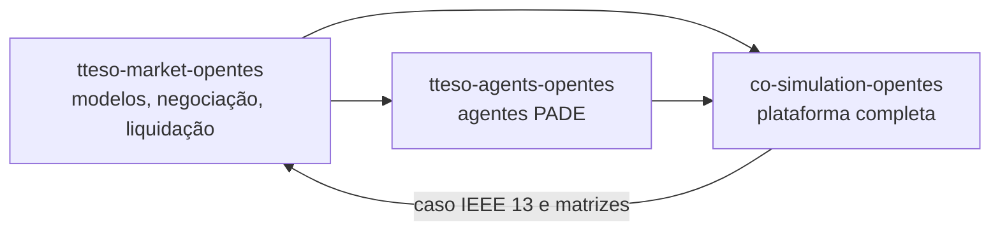

# Os repositórios do TTESO

O mercado foi desenvolvido dentro da plataforma de co-simulação do OpenTES e
depois separado em três repositórios, cada um útil sozinho.

| Repositório | Roda | Responde |
|---|---|---|
| **tteso-market-opentes** (este) | a negociação num laço único, sem mensagens; a operação pelo modelo linearizado | a decomposição converge? em quantas rodadas? o que cada formulação custa? |
| [tteso-agents-opentes](https://grei-ufc.github.io/tteso-agents-opentes/) | a mesma negociação entre agentes PADE que trocam mensagens FIPA-ACL, sem mosaik | os agentes chegam ao mesmo acordo? o que acontece quando mensagens se perdem? |
| [co-simulation-opentes](https://grei-ufc.github.io/co-simulation-opentes/) | agentes, rede de comunicação no OMNeT++, rede elétrica no OpenDSS e mosaik | o que a negociação prometeu se confirma no fluxo de potência? quanto tempo ela gasta numa rede de rádio? |

## O mesmo código

O pacote `market_opentes` é o mesmo da pasta `simulators/market-opentes` do
co-simulation-opentes. As diferenças são de empacotamento:

- o caso vem dentro do pacote, em `market_opentes/dados/ieee13/`, em vez de ser
  lido da pasta do simulador da rede elétrica;
- os comandos têm valores padrão para rodar fora dos contêineres (caminho do
  caso, pasta de saída, teto de 300 rodadas).

Com a configuração padrão, a negociação deste repositório e o
`./run.sh centralizado` do co-simulation-opentes dão os mesmos arquivos de
liquidação, byte a byte.

## Separar o risco numérico do risco de comunicação

A razão para a negociação rodar sem agentes é a mesma da plataforma: se a
decomposição não convergir aqui, não vai convergir distribuída. Este
repositório isola a matemática do mercado; o de agentes acrescenta a troca de
mensagens; a co-simulação acrescenta a rede de rádio e o fluxo de potência.
